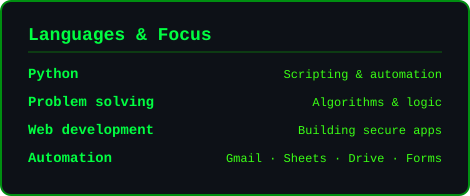

 

 

## 👋 About Me

I'm **Edzlee M. Codera**, a **BSIT student** building a foundation for a career in **cybersecurity**. I'm learning how systems work, how they get attacked, and how they can be defended, and I'm putting that knowledge into practice through projects in Python, Linux, networking, and web development.

## 🎯 Areas of Interest

<table>
  <tr>
    <td width="33%" valign="top" align="center">

### 🛡️ Cybersecurity
Learning how threats work and how to **defend systems against them**.

  </td>
    <td width="33%" valign="top" align="center">

### 🌐 Networking
Understanding how data moves, and where it can be **intercepted or protected**.

  </td>
    <td width="33%" valign="top" align="center">

### 🐧 Linux / CLI
Building comfort and speed in the **terminal and command line**.

  </td>
  </tr>
  <tr>
    <td width="33%" valign="top" align="center">

### 🐍 Python
Scripting, automation, and **small practical tools**.

  </td>
    <td width="33%" valign="top" align="center">

### 💻 Web Development
Building web apps with **security in mind** from the start.

  </td>
    <td width="33%" valign="top" align="center">

### ⚙️ Automation
Connecting everyday tools to **remove repetitive work**.

  </td>
  </tr>
</table>

## 🧰 Technologies & Tools

![ChatGPT](https://img.shields.io/badge/ChatGPT-0d1117?style=for-the-badge&logo=data:image/svg%2Bxml;base64,PHN2ZyByb2xlPSJpbWciIHZpZXdCb3g9IjAgMCAyNCAyNCIgeG1sbnM9Imh0dHA6Ly93d3cudzMub3JnLzIwMDAvc3ZnIj48dGl0bGU%2BT3BlbkFJPC90aXRsZT48cGF0aCBmaWxsPSIjMzlmZjE0IiBkPSJNMjIuMjgxOSA5LjgyMTFhNS45ODQ3IDUuOTg0NyAwIDAgMC0uNTE1Ny00LjkxMDggNi4wNDYyIDYuMDQ2MiAwIDAgMC02LjUwOTgtMi45QTYuMDY1MSA2LjA2NTEgMCAwIDAgNC45ODA3IDQuMTgxOGE1Ljk4NDcgNS45ODQ3IDAgMCAwLTMuOTk3NyAyLjkgNi4wNDYyIDYuMDQ2MiAwIDAgMCAuNzQyNyA3LjA5NjYgNS45OCA1Ljk4IDAgMCAwIC41MTEgNC45MTA3IDYuMDUxIDYuMDUxIDAgMCAwIDYuNTE0NiAyLjkwMDFBNS45ODQ3IDUuOTg0NyAwIDAgMCAxMy4yNTk5IDI0YTYuMDU1NyA2LjA1NTcgMCAwIDAgNS43NzE4LTQuMjA1OCA1Ljk4OTQgNS45ODk0IDAgMCAwIDMuOTk3Ny0yLjkwMDEgNi4wNTU3IDYuMDU1NyAwIDAgMC0uNzQ3NS03LjA3Mjl6bS05LjAyMiAxMi42MDgxYTQuNDc1NSA0LjQ3NTUgMCAwIDEtMi44NzY0LTEuMDQwOGwuMTQxOS0uMDgwNCA0Ljc3ODMtMi43NTgyYS43OTQ4Ljc5NDggMCAwIDAgLjM5MjctLjY4MTN2LTYuNzM2OWwyLjAyIDEuMTY4NmEuMDcxLjA3MSAwIDAgMSAuMDM4LjA1MnY1LjU4MjZhNC41MDQgNC41MDQgMCAwIDEtNC40OTQ1IDQuNDk0NHptLTkuNjYwNy00LjEyNTRhNC40NzA4IDQuNDcwOCAwIDAgMS0uNTM0Ni0zLjAxMzdsLjE0Mi4wODUyIDQuNzgzIDIuNzU4MmEuNzcxMi43NzEyIDAgMCAwIC43ODA2IDBsNS44NDI4LTMuMzY4NXYyLjMzMjRhLjA4MDQuMDgwNCAwIDAgMS0uMDMzMi4wNjE1TDkuNzQgMTkuOTUwMmE0LjQ5OTIgNC40OTkyIDAgMCAxLTYuMTQwOC0xLjY0NjR6TTIuMzQwOCA3Ljg5NTZhNC40ODUgNC40ODUgMCAwIDEgMi4zNjU1LTEuOTcyOFYxMS42YS43NjY0Ljc2NjQgMCAwIDAgLjM4NzkuNjc2NWw1LjgxNDQgMy4zNTQzLTIuMDIwMSAxLjE2ODVhLjA3NTcuMDc1NyAwIDAgMS0uMDcxIDBsLTQuODMwMy0yLjc4NjVBNC41MDQgNC41MDQgMCAwIDEgMi4zNDA4IDcuODcyem0xNi41OTYzIDMuODU1OEwxMy4xMDM4IDguMzY0IDE1LjExOTIgNy4yYS4wNzU3LjA3NTcgMCAwIDEgLjA3MSAwbDQuODMwMyAyLjc5MTNhNC40OTQ0IDQuNDk0NCAwIDAgMS0uNjc2NSA4LjEwNDJ2LTUuNjc3MmEuNzkuNzkgMCAwIDAtLjQwNy0uNjY3em0yLjAxMDctMy4wMjMxbC0uMTQyLS4wODUyLTQuNzczNS0yLjc4MThhLjc3NTkuNzc1OSAwIDAgMC0uNzg1NCAwTDkuNDA5IDkuMjI5N1Y2Ljg5NzRhLjA2NjIuMDY2MiAwIDAgMSAuMDI4NC0uMDYxNWw0LjgzMDMtMi43ODY2YTQuNDk5MiA0LjQ5OTIgMCAwIDEgNi42ODAyIDQuNjZ6TTguMzA2NSAxMi44NjNsLTIuMDItMS4xNjM4YS4wODA0LjA4MDQgMCAwIDEtLjAzOC0uMDU2N1Y2LjA3NDJhNC40OTkyIDQuNDk5MiAwIDAgMSA3LjM3NTctMy40NTM3bC0uMTQyLjA4MDVMOC43MDQgNS40NTlhLjc5NDguNzk0OCAwIDAgMC0uMzkyNy42ODEzem0xLjA5NzYtMi4zNjU0bDIuNjAyLTEuNDk5OCAyLjYwNjkgMS40OTk4djIuOTk5NGwtMi41OTc0IDEuNDk5Ny0yLjYwNjctMS40OTk3WiIvPjwvc3ZnPg%3D%3D)

## 📚 Currently Learning

| Focus | What I'm working on |
|:--|:--|
| **Workflow automation** | Connecting Gmail, Google Sheets, Drive, and Forms to build hands-off pipelines that move data where it needs to go |
| **Problem solving & logic** | Strengthening my foundations in algorithms and programming to write cleaner, more efficient code |

## 🧭 Goals

- Build a strong base in **networking, Linux, and security fundamentals**
- Practice safely and legally in **home labs and learning platforms**
- Ship small **Python tools and web projects** and document what I learn
- Work toward a career in **cybersecurity**

## 🔐 Guiding Principles

| 🔍 UNDERSTAND | 🎯 ANTICIPATE | 🔐 SECURE |
|:---:|:---:|:---:|
| **the threat** | **the attack** | **the future** |
| Learn how attackers think and what they target | Spot weak points before they're exploited | Build defenses that hold up in the real world |

## 📊 GitHub Stats

## 🏆 Contribution Activity

**UNDERSTAND THE THREAT. ANTICIPATE THE ATTACK. SECURE THE FUTURE.**

[Portfolio](https://portfolio-alpha-kohl-ifhk6q45ay.vercel.app/) · [GitHub](https://github.com/edzleecodera-pixel) · [LinkedIn](https://www.linkedin.com/in/edzlee-codera)

